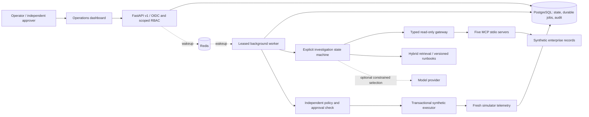
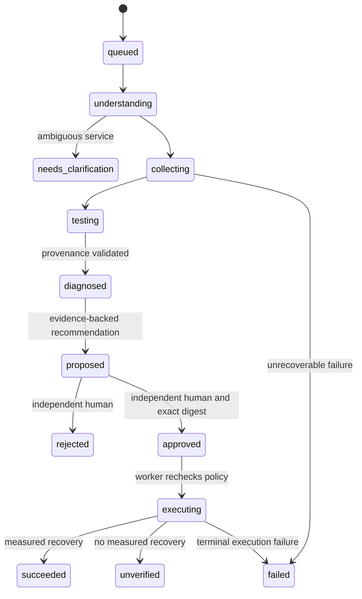

# Architecture

## Investigation state

The action states are a separate state machine inside an investigation; a
diagnosis can be complete while its remediation awaits approval. Pydantic
schemas hold the description, service/time scope, plan, observations, hypotheses,
evidence, calls, actions, approvals, confidence and final report. Conversation
history is not the system of record.

## Correlation and reasoning

The engine discovers source tools through a catalog, collects independent
records concurrently, reads diagnostic rules from versioned runbooks and tests
all retrieved rules against observed signals. Missing signals, contradictions,
source failures and close competing scores prevent high-confidence conclusions.
The engine can abstain. It never reads fixture labels.

Runbook recommendations remain inert data. Hybrid retrieval searches for
remediation guidance; exact source IDs and content hashes are retained. All
conclusions must reference stored, nonquarantined evidence. The optional model
only offers a constrained second opinion after deterministic testing.

## Persistence and distributed work

PostgreSQL is chosen for transactions covering investigation state, approvals,
execution idempotency and jobs. Job claims use leases and
`FOR UPDATE SKIP LOCKED`; updates check version and lease ownership. Jobs retry
with exponential delay and a maximum attempt count. A stale worker cannot
commit its result. Redis is an accelerator, not a second authoritative queue.

The initial release uses a bootstrap schema command. Future schema evolution
requires ordered migrations and expand/contract deployment, not changes to
`create_all`. SQLite is for local development and deterministic tests only.

Each simulator effect, fresh telemetry sample, execution record, report update
and audit event commits atomically. No network write is hidden inside that
transaction. A future live executor must use provider idempotency tokens and an
outbox/reconciliation workflow; database transactions alone cannot make remote
side effects exactly once.

## Retrieval

Ingestion stores chunk offsets, hashes and document metadata. Signed feature
hashes provide a cheap deterministic offline vector baseline; they are lexical,
not learned semantic embeddings. An explicit `OpenAIEmbedder` adapter is available
for governed external embedding. BM25 and cosine rankings are fused and
phrase-reranked. Exact search is bounded to 10,000 chunks and appropriate for
this reference corpus; production scale needs a tenant-filtered vector index.

## Deployment topology

The AWS reference uses a VPC with public ingress and private application/data
subnets, an HTTPS ALB, separate ECS Fargate API/worker services, RDS PostgreSQL,
ElastiCache Redis, ECR, CloudWatch and Secrets Manager. Terraform defines the
resources; an authorized workflow builds an immutable image, performs schema
bootstrap/migration as a one-off task and rolls services forward. Infrastructure
provisioning is not proof that the product is production-ready.
